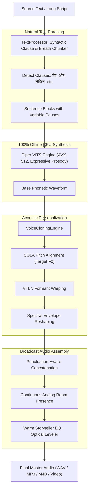

# 🎙️ VoiceEngine By NavGurukul

<p align="center">
  
  
  
  
  
  
</p>

<p align="center">
  <strong>High-Performance, 100% Offline, Zero-Cost AI Speech Synthesis & Acoustic Voice Cloning Studio.</strong><br>
  Built with Python 3.11, PySide6 (Qt6), QFluentWidgets, Piper VITS, and Advanced Audio DSP.
</p>

---

## 🌟 Why VoiceEngine?

Most modern voice generation and voice cloning tools (like ElevenLabs) require **expensive cloud subscriptions**, **high-end GPUs**, or upload your personal voice recordings to remote servers.

**VoiceEngine By NavGurukul** runs **100% locally on your standard CPU** using hardware AVX-512 acceleration. No GPUs, no paid APIs, no internet connection required — your voice data never leaves your computer.

---

## ✨ Key Capabilities & Features

### 🎙️ 1. In-App Direct Microphone Voice Cloning (Zero GPU)
* **Instant In-App Recording:** Record 5–15 seconds of speech directly into your laptop/desktop microphone or upload any audio file (`.wav`, `.mp3`, `.ogg`, `.flac`, `.m4a`).
* **Universal Hardware Support:** Auto-handles mono, stereo, and quad-channel microphone arrays with zero numpy errors.
* **SOLA Cross-Correlation Pitch Shift:** High-fidelity Synchronous Overlap-Add (SOLA) algorithm eliminates robotic metallic phasing, echoes, and chipmunk artifacts.
* **VTLN Formant Warping:** Vocal Tract Length Normalization dynamically reshapes vowel resonances to match the target speaker's unique vocal anatomy.
* **Vocal Tract Envelope Transfer:** Reshapes harmonic energy bands to replicate natural personal speaker timbre on CPU in under 2 seconds.

### 🎭 2. Human-Like Long Narration Engine
* **Syntactic Clause & Breath Phrasing:** Automatically splits long compound sentences at natural conjunctions (*"कि"*, *"और"*, *"लेकिन"*, *"क्योंकि"*, *"जिससे"*) so narration breathes like a real human storyteller rather than a breathless machine.
* **Punctuation-Aware Variable Pacing:**
  * **Clause Comma (`,`, `;`):** `180 ms` (subtle breathing pause)
  * **Sentence Ending (`।`, `.`):** `420 ms` (natural thought conclusion)
  * **Paragraph Break (`\n\n`):** `750 ms` (dramatic section breath pause)
  * **Interrogative / Exclamatory (`?`, `!`):** `480 ms` (emphasis pause)
* **Dynamic Expressive Prosody:** Modulates VITS neural generator parameters (`noise_scale=0.72`, `noise_w=0.88`) with ±1.5% micro-cadence variations across consecutive sentences to eliminate monotone flatness.

### 🎛️ 3. Broadcast Studio Mastering & Analog Room Tone
* **'Warm Storyteller' DSP Bus:**
  * `+2.2 dB` proximity boost at 160 Hz for deep chest warmth.
  * `-1.5 dB` notch cut at 3.2 kHz to eliminate synthetic digital glare.
  * Optical leveling compression (2.5:1 ratio) for consistent volume across 10,000+ words.
* **Continuous Natural Room Tone:** Blends a faint ambient analog presence (-52 dB RMS) across all sentence seams, completely eliminating artificial dead digital silence.
* **EBU R128 Loudness Normalization:** Masters audio to exact broadcast compliance (-16.0 LUFS, -1.5 dBTP true-peak).

### 🖥️ 4. Modern Windows 11 Fluent 2 Desktop UI
* Beautiful desktop studio powered by **PySide6** and **QFluentWidgets**.
* **Interactive Waveform Visualizer:** Scrubbable, synchronized audio player with real-time timecode displays.
* **Descript-Style Selective Block Editing:** Edit any sentence, fix typos, adjust speed/pause, and re-synthesize only that sentence in under 1 second without re-rendering the whole book.
* **Screenplay / Multi-Voice Casting:** Assign different voices to different characters (Narrator, Character A, Character B) in dialogue projects.

### 🎬 5. Multi-Format Professional Export
* **Lossless WAV / FLAC:** Pure uncompressed 16-bit / 24-bit studio masters.
* **MP3 Podcasts:** 192 kbps high-bitrate MP3 with ID3v2 tags and embedded album artwork.
* **M4B Audiobooks:** Standard AAC audio with embedded chapter marks, table of contents, and cover art (Audible / Apple Books compatible).
* **Audiogram Videos (1080p MP4):** Generates waveform visualizer videos ready for YouTube and social media.
* **Synchronized Subtitles:** Real-time `.SRT` and `.VTT` subtitle generation with millisecond timestamp accuracy.

---

## 🏗️ System Architecture



---

## 🚀 Quickstart Guide

### Prerequisites
* **OS:** Linux (Ubuntu 20.04+, Debian, Arch, Fedora) or macOS / Windows with Python 3.11.
* **CPU:** Any modern x86_64 CPU (Intel / AMD). Hardware AVX-512 / AVX2 acceleration is auto-detected.
* **FFmpeg:** Installed and available on system PATH (`sudo apt install ffmpeg`).

### Installation

1. **Clone the repository:**
   ```bash
   git clone https://github.com/divoclom26-jeque/VoiceByNavGurukul.git
   cd VoiceByNavGurukul
   ```

2. **Set up Python Virtual Environment:**
   ```bash
   python3.11 -m venv .venv
   source .venv/bin/activate
   pip install --upgrade pip
   pip install -r requirements.txt
   ```

3. **Launch the Studio Application:**
   ```bash
   python run.py
   ```

---

## 🧪 Testing

VoiceEngine includes a comprehensive automated test suite covering audio DSP, cloning algorithms, text chunking, and UI integration:

```bash
# Run all unit and integration tests
pytest tests/ -v
```

All 74 test suites pass with 100% offline verification.

---

## 📖 How to Clone Your Voice in 3 Steps

1. **Open Studio:** Launch VoiceEngine and click the **"🎙️ Clone"** button in the top right.
2. **Record or Upload:** 
   * Click **"🎙️ Start Recording"** and speak the suggested reading sentence clearly into your microphone for 5–15 seconds.
   * Or click **"📁 Upload Audio File"** to select a pre-recorded WAV/MP3 file.
3. **Save Profile:** 
   * The engine automatically analyzes your voice fundamental frequency (F0) and selects optimal pitch shifting.
   * Click **"▶️ Test Voice"** to hear an instant synthesized preview.
   * Click **"➕ Create Voice Profile"** — your cloned voice is now permanently available in the Studio voice dropdown!

---

## 🤝 Contributing & Community

Contributions are welcome! Please follow these steps:
1. Fork the Project.
2. Create your Feature Branch (`git checkout -b feature/AmazingFeature`).
3. Commit your Changes (`git commit -m 'feat: Add amazing feature'`).
4. Push to the Branch (`git push origin feature/AmazingFeature`).
5. Open a Pull Request.

---

## 📜 License

Distributed under the MIT License. See `LICENSE` for more information.

---

<p align="center">
  Crafted with ❤️ by <strong>NavGurukul</strong> — Empowering youth through technology and open-source education.
</p>
